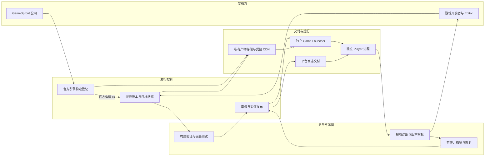

# 01 · GameSprout Game Launch Platform 架构

返回 [文档入口](README.md)。本文定义平台整体职责和端到端契约。具体状态、数据字段、下载策略和故障响应见各专项文档。

## 目标与产品边界

创作者在 GameSprout Editor 中选择发布目标，提交一次游戏发行。每个目标独立完成构建、验证、签名和渠道提交。玩家在独立 Game Launch Platform 中看到自己设备可用的游戏版本，能够安装、更新、启动和恢复。开发者能查到发行状态和真实设备上的问题，并用对应的构建与资源版本复现。

公司发行官方 EngineBuild。开发者发行 GameRelease，声明依赖一个或多个目标对应的官方 EngineBuild。同一引擎构建可以服务许多游戏，同一游戏也可逐步迁移引擎。Launcher 自身的版本独立推进。目标之一是让这些版本的对应关系持久、可校验、可追溯。

一次提交是开发者的工作流。各目标的可用时间受构建队列、审核、签名和渠道进度影响。目录只给设备展示当前已可用的目标。首轮做 macOS 私有发行的完整闭环，公开平台和新增目标按验证结果扩展。

## 系统地图

上图是目标架构。分发一份引擎时可以独立登记 EngineBuild，首版仍可将该构建与游戏装入按平台完整签名的 Player。共享缓存是后续可选优化，发行数据模型从首版就能表达引擎依赖。

## 职责与访问边界

| 角色或组件 | 拥有的数据和职责 | 对外协作 |
| --- | --- | --- |
| GameSprout 公司 | 引擎 SDK、Player 模板、官方 EngineBuild、兼容范围、签名策略和引擎生命周期 | 发布不可变官方构建及其摘要，维护受影响游戏的反向索引 |
| 开发者与团队 | 自己游戏的源码、资源、版本、渠道权限和更新说明 | 从 Editor 提交已构建产物或请求受支持的构建，读取本团队发行、失败和诊断 |
| Editor 发行 Module | 本地目标构建请求、凭据使用、上传任务、进度、取消和恢复 | 通过公共接口复用 BuildSetting、AssetsPipeline 和 ScriptCompiler，向 View 发事件与快照 |
| Editor 发行 View | 发布表单、平台可用性、构建/审核结果、资源与错误定位 | 使用 `.ui`，按事件刷新并经 Module 执行命令 |
| 发行服务 | 游戏和发布方身份、权限、不可变版本、平台目标、渠道指向、撤销与审计 | 对 Editor、运营后台和 Launcher 暴露版本化 API，按租户授权 |
| 构建与签名服务 | 隔离构建、产物验证、设备试验、来源记录、目标渠道签名 | 构建机提交摘要与证据，签名服务核对批准记录后处理。本地导出使用同一接收验证流程 |
| 下载与安装组件 | 交付清单、下载授权、预算、缓存、暂存、激活、回滚和路径 | Launcher 负责产品状态与用户操作，平台渠道负责各自的原生安装 |
| Player / Runtime | 独立游戏进程、GameLogic、资源、帧循环、动画、物理、游戏 UI 与输入 | 只接收已验证版本的启动参数和所需游戏权限。符号、运行统计经受控诊断接口解释 |
| GRHI / Foundation | GRHI 负责绘制、设备、提交与固定后端。Foundation 提供已使用的基础能力 | 引擎打包依据实际链接与部署依赖，Foundation 可随二进制静态链接 |
| 运营与支持 | 发布审批、下架、事件、故障演练、预算、访问权限和证据留存 | 用版本、游戏、区域或设备范围执行可审计操作 |

任何使用者提供的文件、配置和原生 GameLogic 都跨越信任边界。完整包的发行签名和原生进程的权限隔离各自承担独立职责。Launcher 保管平台登录凭据。Player 使用只适用于该游戏和用户会话的授权，运行崩溃不应带走 Launcher。游戏离线权益、权限范围和存档位置由 [发行与信任](02-release-and-trust.md) 和 [分发与安装](03-delivery-and-installation.md) 细化。

实现新 Editor 功能遵守 [仓库约定](../AGENTS.md) 与 [模块边界](../GameSprout/Docs/EditorModuleBoundaries.md)。Runtime 保持无 Qt、无 Editor 依赖。Launcher 与平台后端通过明确协议交互。实际技术栈和数据库实施细节在试点时根据事务、鉴权、队列与运维能力选择。

## 核心记录及关系

* **EngineBuild** 是公司发布的一套不可变二进制。目标至少区分 OS、架构、图形后端和兼容 ABI，登记 SDK/工具链、所含依赖和文件摘要。可读版本号用于显示，构建 ID 用于安装和追溯。
* **GameRelease** 是某个游戏的一次不可变发布结果。含游戏 ID、版本、启动场景、允许的目标、对应引擎构建 ID、GameLogic ABI、包版本、符号与证据引用。每个目标可以单独失败或重新产生候选构建。
* **发布渠道** 指向一个或多组已批准的目标，带生效范围、时间及代次。灰度、正式、下架和回滚以变更受审计的渠道指向实施。目标文件内容从发布后保持不可变。
* **安装记录** 保存一个已校验的「游戏版本、目标、引擎构建 ID、应用包摘要」组合。当前版本、上一可用版本和在运行版本的回收时机分开。存档按游戏与用户存放。
* **诊断证据** 用游戏版本、引擎构建 ID、目标和运行环境把发行、下载、启动和运行问题连起来。成功或失败的设备检查、符号和复现条件随候选版本保存。开发者只看到有权限查看的游戏数据。

具体字段与状态见 [发行与信任](02-release-and-trust.md)。记录名是设计术语，接口实施需在实现变更中确认与迁移。

### 从一次发布跑到一次启动

1. 公司为所支持的目标生成官方引擎和 SDK，验证后以构建 ID 发布。
2. 开发者在 Editor 选游戏版本和各目标。构建输出按场景依赖收集资源，生成目标 Shader 与 GameLogic，锁定引擎构建。
3. 发行服务接收候选并隔离存放产物。验证输出、包兼容性及签名，执行设备检查。符合权限的发布者或运营将通过的目标推到指定渠道。
4. Launcher 查询目录、匹配平台和架构，再获取指定发布清单与交付授权。桌面端可通过公司渠道下载完整包。移动原生应用走对应商店或获准的分发渠道。
5. Launcher 暂存并验证新版本，在可恢复事务里激活。按目标启动独立 Player。游戏进程读与版本匹配的资源和逻辑，存档有独立位置。
6. Launcher 和 Player 报告所允许的版本、启动、安装和性能信息。运营按批次控制曝光，开发者根据受控诊断在 Editor 复现并验证下一版。

## 目标平台与当前代码

下表区分后端策略、仓库已有的导出能力和仍需补齐的发行验证。没有记录通过的测试保留为待验。

| 玩家目标 | 固定图形后端 | 当前 Player 导出路径 | 平台发行需要补齐 |
| --- | --- | --- | --- |
| macOS | Metal | Editor 导出 `.app`，签名函数用 ad hoc 签名，已实际运行 FantasyKingdom | 正式 Developer ID 签名与公证，干净机器安装、可重复的包内交互检查 |
| Windows | D3D12 | GRHI 有后端和 Player 原生 `.dll` 装载分支。BuildPlatform 尚无 Windows 导出器 | Windows 构建环境、启动壳打包、发布签名及真实设备验证 |
| Linux | Vulkan | macOS Editor 通过 Linux 构建机导出 `.tar.gz`，产物架构随构建机 | 发行运行库基线、目标系统和驱动兼容验证、安装与启动体验 |
| iOS | Metal | 有 iOS 构建脚本和 Player 壳，当前导出路径生成应用包 | App Store 渠道、签名、正式设备和渠道测试。商店版的原生代码随认可的应用包发布 |
| Android | Vulkan | 有 Android 导出脚本，当前生成 APK，默认 arm64-v8a 与调试签名 | 正式签名、渠道产物及实机、按渠道约束选择资源交付 |
| HarmonyOS | Vulkan | 有 HAP 与 DevEco 工程导出，API 24 未签名 HAP 已构建验证 | 签名、AppGallery 渠道产物和实体设备的验证 |
| macOS Server / Linux Server | 无图形 Player 会话 | 当前有 Headless 目标和独立启动逻辑 | 属于服务端运行产物，维护独立的部署和协议兼容性 |

图形后端保持平台固定。现阶段 Build Setting 的平台构建入口受主机条件限制，不能以 Launcher 能运行的设备反推 Editor 在同一设备能导出其他平台。代表性的仓库入口见 [BuildPlatform](../GameSprout/Module/Interface/IBuildSetting.h)、[GRHI 驱动选择](../GameSprout/GRHI/GRHI/DeviceSDL.cpp)、[Player 装载流程](../GameSprout/GameSproutPlayer/PlayerMain.cpp)、[各目标导出目录](../GameSprout/GameSproutPlayer/Platforms)。平台渠道核验入口见 [Apple 审核指南](https://developer.apple.com/app-store/review/guidelines/)、[Google Play 执行代码政策](https://support.google.com/googleplay/android-developer/answer/16559646)、[AppGallery 审核指南](https://developer.huawei.com/consumer/en/doc/app/50104-03/)。

### 当前可以直接复用的能力

| 代码位置 | 可复用能力 |
| --- | --- |
| [BuildSetting](../GameSprout/Module/BuildSetting) | 选择与激活目标分离，Build Profiles、场景列表、构建任务、平台导出 |
| [BuildInputs](../GameSprout/Module/BuildSetting/BuildInputs.cpp) | 按启用场景收集 GUID 与 Local ID 依赖，构建按目标资源与代码输入 |
| [PlayerBuildJob](../GameSprout/Module/BuildSetting/PlayerBuildJob.cpp) | 暂存构建、检查复制摘要、写入 Player 清单，打包与本地发布 |
| [PlayerPackage](../GameSprout/GameSproutPlayer/PlayerPackage.cpp) | 读取本地 `Player.json`，验证产物格式与版本，用首个启用场景启动 |
| [RuntimeScriptApi](../GameSprout/GameSproutRuntime/Api/RuntimeScriptApi.h) | 跟踪原生 GameLogic 的 ABI，声明匹配 SDK 与编译器的要求 |
| [RuntimeRenderApi](../GameSprout/GameSproutRuntime/Api/RuntimeRenderApi.h) | 渲染统计与诊断入口，可用于设备兼容性与性能验收 |
| [现有 GameSproutHub](../GameSprout/GameSproutHub/HubProjectManager.cpp) | 管理本地工程并启动 Editor。玩家 Launcher 的代码复用与产品入口仍可单独决定 |

## 公司规模下需要积累的能力

CDN、对象存储、账号等可以采用成熟服务。GameSprout 最值得积累的是从 **资源依赖、目标构建、真实安装与输入、设备故障、Editor 复现，再到灰度修复** 的闭环。每次提交都能解释目标包变了哪些内容。每次事故都能定位受影响的发行与设备范围。每次修复都能把已验收的风险沉淀为可复跑的用例。

第一轮按 [路线图与验收](05-roadmap-and-acceptance.md) 验证闭环。公开发行的安全、成本和运维门槛见 [运营与质量](04-operations-and-quality.md)。
