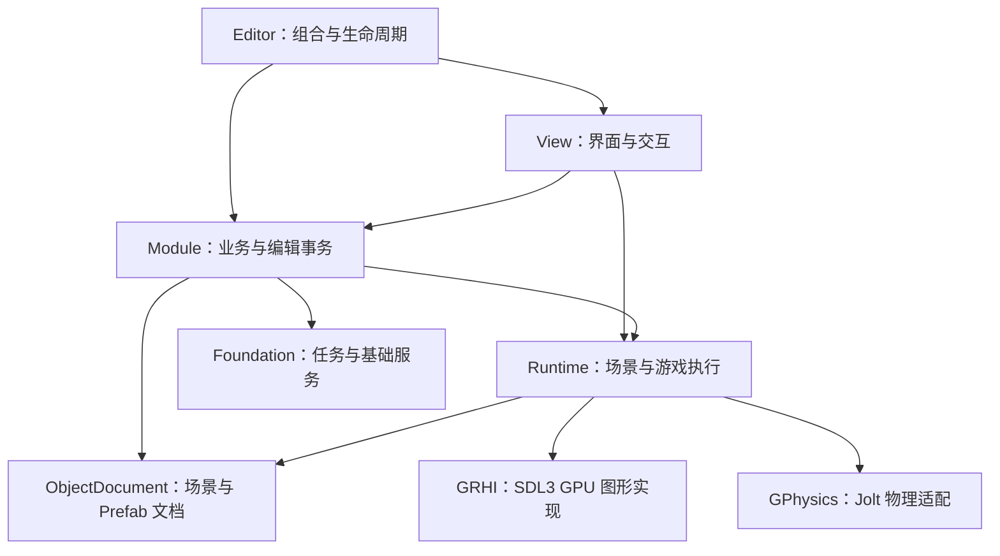

<div align="center">

# GameSprout

**面向 AI 辅助游戏创作的 C++ 引擎与模块化编辑器**

独立 Runtime · 原生 C++ 游戏逻辑 · 可追踪资源管线 · 场景与运行一体化工作流

[核心能力](#核心能力) · [架构设计](#架构设计) · [构建与启动](#构建与启动) · [示例项目](#示例项目) · [开发方向](#开发方向)

</div>


![GameSprout Editor 在 macOS 上编辑大型三维城堡场景，展示 Scene、Hierarchy、Inspector、Project 与 Console 工作区]

<p align="center"><em>GameSprout Editor 实机截图：在同一工作区中组织场景、预览画面、管理资产与编辑属性。</em></p>

## 关于项目

GameSprout 使用 **C++20** 构建引擎核心，以 **Qt Widgets** 提供桌面编辑器，覆盖场景编辑、资源导入、原生脚本编译、动画、物理和实时渲染。开发者可以在编辑器中组织内容，在 Game 视图中运行并观察游戏状态，并通过公共 Runtime SDK 编写游戏逻辑。

项目围绕一套明确的边界展开：**View 负责交互与展示，Module 负责业务与编辑事务，Runtime 负责游戏运行与渲染。** 同一套 Runtime 可以供编辑器和独立游戏宿主复用，其核心不依赖 Qt 或编辑器私有实现。

长期方向是把 Agent 融入编辑器，让自然语言、代码和资产制作围绕同一份项目数据协作：读取场景、执行编辑、生成代码、编译验证，再根据实际结果继续调整。

> **项目状态：持续开发中。** 编辑器、资源管线与 Runtime 已有实际实现；本地模型聊天已有原型。编辑器内 Agent 的工具执行闭环，以及独立游戏构建与发布流程，仍在推进中。

## 核心能力

### 场景编辑与工作区

- **Scene / Game 双视图**：编辑场景与运行游戏共享 Runtime 能力，保留不同的视口和交互状态。
- **模块化编辑面板**：Hierarchy、Inspector、Project、Console 等面板支持停靠、分组、拆分和浮动布局。
- **对象与组件编辑**：变换工具、组件属性、对象选择、Tag、Layer 和静态标记。
- **编辑事务**：撤销 / 重做、连续拖动预览与提交、场景保存和恢复。
- **Prefab 工作流**：创建、实例化、覆盖、Apply / Revert，以及独立 Prefab Stage 编辑。
- **编辑态与运行态隔离**：Play、Pause、Step；停止运行后恢复作者场景，避免游戏运行直接改写编辑数据。

### 资源与导入管线

- 使用 **GUID + LocalID** 标识资源与子资源，区分源文件、导入设置和运行产物。
- 对模型、贴图、材质、动画、场景、Prefab、Shader 等资源执行预处理与依赖追踪。
- 后台执行导入任务，在宿主线程校验与发布，拦截已被后续修改取代的结果。
- 通过文件、设置与工具链指纹管理缓存和重导入。
- 以暂存目录、发布日志和数据库事务协调产物更新，保留失败回滚与中断恢复路径。
- Runtime 通过资源提供者读取预处理产物，编辑器资产管理与运行资源使用保持分离。

### 渲染与图形

- **GRHI + SDL3 GPU**：公共图形接口与私有后端实现分离。
- 网格、材质、自定义 HLSL Shader、深度测试、GPU 实例化和骨骼蒙皮。
- 方向光、级联阴影、环境漫反射、球谐环境光、天空与距离雾。
- 视锥剔除、静态阴影复用，以及多视口共享设备与渲染资源。
- 原生窗口呈现、离屏渲染与显式像素读回。

### 动画、物理与游戏 UI

- **动画**：Clip、Animator Controller、1D 混合、动画层与 Mask、Root Motion、动画事件、Humanoid 重定向及 IK。
- **物理**：基于 Jolt Physics 的刚体、基础碰撞体、网格与凸包碰撞体、射线查询、碰撞 / 触发事件和碰撞层。
- **游戏 UI**：Runtime 中的 Canvas、RectTransform、Image、Text、Button、布局与指针交互，不依赖编辑器的 Qt 控件。

### 原生 C++ 游戏逻辑

- 使用公共 Runtime SDK 编写脚本和游戏模块，通过注册工厂创建外部游戏代码中的类型。
- 支持字段反射、序列化、对象 / 组件引用、编译诊断和动态模块装载。
- 以源码快照、工具链指纹和内容哈希管理增量编译。
- 按 EarlyUpdate、固定步物理、Update、动画求值、LateUpdate 组织帧执行。
- macOS 提供 Xcode 外部代码工程入口，与编辑器共用脚本构建流程。

实现与使用细节见 [原生脚本工作流](GameSprout/Module/ScriptEditor/README.md)、[外部代码工程](GameSprout/Module/CodeEditor/README.md) 和 [Prefab 工作流](GameSprout/Module/PrefabManager/README.md)。

## 架构设计



几个贯穿代码的约定：

- **通过公共接口协作**：功能模块不包含或编译其他模块的私有实现。
- **界面由 `.ui` 定义**：Inspector 页面、资源菜单和组件编辑器由对应功能 View 注册。
- **以事件更新界面**：先订阅，再读取初始快照；后续响应选择、场景、资源和播放事件。
- **保持运行时所有权清晰**：Editor 组合层拥有 Runtime，Module / View 借用公共接口；RuntimeHost 统一推进运行帧。
- **把编辑放入事务**：场景作者数据、运行时临时状态和资源发布各自有明确的修改边界。

详细说明：[编辑器模块边界与事件协议](GameSprout/Docs/EditorModuleBoundaries.md)。

### 仓库结构

| 目录 | 职责 |
| --- | --- |
| [`GameSprout/GameSproutEditor`](GameSprout/GameSproutEditor) | 编辑器组合层、插件加载和生命周期 |
| [`GameSprout/Module`](GameSprout/Module) | 场景、资源、脚本、Prefab、运行控制等业务模块 |
| [`GameSprout/View`](GameSprout/View) | Qt 面板、组件编辑器与交互 |
| [`GameSprout/GameSproutRuntime`](GameSprout/GameSproutRuntime) | 对象、组件、游戏逻辑、动画、UI 与渲染 |
| [`GameSprout/GRHI`](GameSprout/GRHI) | 图形公共接口与 SDL3 GPU 后端 |
| [`GameSprout/GPhysics`](GameSprout/GPhysics) | Jolt 物理适配与网格烹饪 |
| [`GameSprout/ObjectDocument`](GameSprout/ObjectDocument) | 场景 / Prefab 编解码、校验和分阶段装配 |
| [`GameSprout/Foundation`](GameSprout/Foundation) | 任务、文件、网络等基础服务 |
| [`GameSprout/GameSproutHub`](GameSprout/GameSproutHub) | 独立项目管理程序 |
| [`GameSprout/GameSproutAgent`](GameSprout/GameSproutAgent) / [`Model`](Model) | 本地模型聊天原型、模型配置与请求示例 |
| [`GameSprout/Examples`](GameSprout/Examples) / [`GameSprout/Tools`](GameSprout/Tools) | 可玩示例、Shader 工具与 Unity 场景导出桥 |
| [`GameSprout/Tests`](GameSprout/Tests) | 编辑器与资源流程集成测试 |
| [`Go`](Go) | 独立的 Go 基础服务与插件框架探索 |

## 构建与启动

### 平台与依赖

当前集成验证以 **macOS ARM64 / Metal** 为主。GRHI 已定义 Windows 的 Direct3D 12 和 Linux 的 Vulkan 路径；这些平台仍需继续完成端到端构建与真机运行验证。图形后端的平台分支不代表已具备完整移动端编辑器或游戏发布支持。

| 依赖 | 要求与用途 |
| --- | --- |
| C++ 编译器 | C++20。macOS 使用 Clang / AppleClang。Windows 的 MSVC 构建另需 Clang 进行脚本反射 |
| CMake | 推荐 3.24+；主要工程最低 3.21，ShaderTools 最低 3.24 |
| Ninja | 推荐生成器；各主要工程提供 Debug / Release 预设 |
| Qt | 推荐 Qt 6 开发包，包含 Core、Gui、Widgets；独立聊天程序另需 Network |
| SDL3 SDK | SDL3 3.2+。显卡枚举和显式选卡需要 GRHI 扩展 v2 |
| Git 与依赖下载 | Foundation 使用固定版本的依赖管理配置；Jolt 等依赖在首次配置时获取 |
| Python 3 | 创建示例项目，以及执行部分资源工具 |

macOS 仍使用仓库外的 SDL3 扩展 SDK。Windows 可用官方 SDL3 SDK 启动默认 D3D12 设备。指定物理显卡时使用带扩展的 SDK。通过 `SDL3_DIR` 指定 CMake 包目录。具体契约见 [GRHI 构建说明](GameSprout/GRHI/README.md)。

Windows 的 MSVC Kit 使用同一套 ABI 构建 Editor、Runtime 和 GameLogic。可通过 `GAMESPROUT_SCRIPT_REFLECTION_COMPILER` 显式指定 `clang-cl.exe` 或 LLVM 的 `clang.exe` 进行 AST 反射。macOS 的构建和反射继续使用所选 Clang Kit。见 [脚本生成器](GameSprout/Module/ScriptCompiler/ScriptBindingsGenerator.cpp)。

### Windows x64 构建

使用启用了 MSVC 和 Windows SDK 的 x64 开发者 PowerShell，准备 Qt 6 MSVC x64、Git 和 SDL3。以 `GameSprout` 为 CMake 源目录可统一构建 Foundation、GRHI、Runtime、Editor、Hub、Agent 和 Player。若 SDL3 SDK 已解压到 `Bin/Deps/SDL3Windows` 下的版本目录，聚合入口会自动查找其 CMake 包，也可以通过 `SDL3_DIR` 指定其他 SDK。以下 Visual Studio 2026 命令需要 CMake 4.2 或更新版本。

```powershell
cmake -S GameSprout -B GameSprout/build/VS2026 -G 'Visual Studio 18 2026' -A x64 '-DCMAKE_PREFIX_PATH=C:/Qt/6.12.1/msvc2022_64'
cmake --build GameSprout/build/VS2026 --config Debug
```

各 SDK 默认写入同一个 `Bin`。在同一输出目录中使用一致的架构和构建配置。自定义 Shader 导入所需的 ShaderTools 使用下方的独立构建和安装命令。

也可以使用 Ninja 逐个构建工程，先构建 Foundation、GRHI 和 Runtime，再构建 Editor。

```powershell
$qt = 'C:/Qt/6.12.1/msvc2022_64'
$sdl = 'C:/SDKs/SDL3/cmake'
$clang = 'C:/Program Files/LLVM/bin/clang-cl.exe'
$env:VSLANG = '1033'
cmake -S GameSprout/Foundation -B GameSprout/Foundation/build/Ninja_Debug -G Ninja -DCMAKE_BUILD_TYPE=Debug
cmake --build GameSprout/Foundation/build/Ninja_Debug
cmake -S GameSprout/GRHI -B GameSprout/GRHI/build/Ninja_Debug -G Ninja -DCMAKE_BUILD_TYPE=Debug "-DSDL3_DIR=$sdl"
cmake --build GameSprout/GRHI/build/Ninja_Debug
cmake -S GameSprout/GameSproutRuntime -B GameSprout/GameSproutRuntime/build/Ninja_Debug -G Ninja -DCMAKE_BUILD_TYPE=Debug
cmake --build GameSprout/GameSproutRuntime/build/Ninja_Debug
cmake -S GameSprout/Tools/ShaderTools -B GameSprout/Tools/ShaderTools/build/Ninja_Release -G Ninja -DCMAKE_BUILD_TYPE=Release "-DSDL3_DIR=$sdl"
cmake --build GameSprout/Tools/ShaderTools/build/Ninja_Release
cmake --install GameSprout/Tools/ShaderTools/build/Ninja_Release
cmake -S GameSprout/GameSproutEditor -B GameSprout/GameSproutEditor/build/Ninja_Debug -G Ninja -DCMAKE_BUILD_TYPE=Debug "-DCMAKE_PREFIX_PATH=$qt" "-DSDL3_DIR=$sdl" "-DGAMESPROUT_SCRIPT_REFLECTION_COMPILER=$clang"
cmake --build GameSprout/GameSproutEditor/build/Ninja_Debug
.\Bin\GameSproutEditor.exe "--ProjectRoot=$((Resolve-Path MountAndBlade).Path)"
```

Windows Editor 导入自定义 Shader 时同时产出 DXIL。Build Settings 的 Windows 目标导出一个目录，包含 `GameSproutPlayer.exe`、运行时 DLL 和 `Game/`。面向普通机器的交付使用 Release 配套产物和对应的 MSVC 可再发行运行库。Debug 构建用于具备开发工具的机器。

### 构建编辑器

```sh
git clone https://github.com/Heroinaddicts/GameSprout.git
cd GameSprout
```

以下命令从**仓库根目录**执行，演示单配置 Ninja Debug 构建。请替换 Qt、SDL3 的本机绝对路径，并先选择兼容的 C++ 工具链。

```sh
# 1. 基础服务
cmake -S GameSprout/Foundation -B GameSprout/Foundation/build/Ninja_Debug \
  -G Ninja -DCMAKE_BUILD_TYPE=Debug
cmake --build GameSprout/Foundation/build/Ninja_Debug

# 2. 图形接口与后端；SDL3_DIR 指向已经准备好的定制 SDK
cmake -S GameSprout/GRHI -B GameSprout/GRHI/build/Ninja_Debug \
  -G Ninja -DCMAKE_BUILD_TYPE=Debug \
  -DSDL3_DIR=/absolute/path/to/SDL/build
cmake --build GameSprout/GRHI/build/Ninja_Debug

# 3. Runtime；自动引入 GPhysics、Jolt 和 ObjectDocument
cmake -S GameSprout/GameSproutRuntime \
  -B GameSprout/GameSproutRuntime/build/Ninja_Debug \
  -G Ninja -DCMAKE_BUILD_TYPE=Debug
cmake --build GameSprout/GameSproutRuntime/build/Ninja_Debug

# 4. Editor；自动构建并部署 Module 与 View 插件
cmake -S GameSprout/GameSproutEditor \
  -B GameSprout/GameSproutEditor/build/Ninja_Debug \
  -G Ninja -DCMAKE_BUILD_TYPE=Debug \
  -DCMAKE_PREFIX_PATH=/absolute/path/to/Qt/platform
cmake --build GameSprout/GameSproutEditor/build/Ninja_Debug
```

主要产物输出到仓库的 `Bin/`。Foundation、GRHI、Runtime 作为独立 SDK 被编辑器消费；不需要另外重复构建全部 Module / View。当前最终产物路径未按配置完全隔离，请保持整套 SDK、编辑器与插件的架构和配置一致，避免不同 Kit 同时写入同一个 `Bin/`。

各主要工程还提供 `ninja-debug` / `ninja-release` 预设；预设命令须在**对应工程目录**运行。Qt Creator 配置、Ninja 路径和预设使用方式见 [构建说明](GameSprout/Docs/NinjaBuild.md)。

<details>
<summary><strong>可选：安装自定义 Shader 工具链</strong></summary>

内置 Shader 已随 Runtime 提供；导入自定义 Shader 时，需要额外准备 DXC、SDL_shadercross 和 SPIRV-Cross。缺少这套工具不会阻止 Editor 启动，但自定义 Shader 导入需要它们。

```sh
# macOS 等没有现成 DXC SDK 的主机，先构建配套 DXC。
# 首次构建包含 LLVM / DXC，耗时明显高于普通模块。
cmake -P GameSprout/Tools/ShaderTools/BuildDXC.cmake

cmake -S GameSprout/Tools/ShaderTools \
  -B GameSprout/Tools/ShaderTools/build/Ninja_Release \
  -G Ninja -DCMAKE_BUILD_TYPE=Release \
  -DSDL3_DIR=/absolute/path/to/SDL/build
cmake --build GameSprout/Tools/ShaderTools/build/Ninja_Release
cmake --install GameSprout/Tools/ShaderTools/build/Ninja_Release
```

默认安装到 `Bin/ShaderTools`。完成后重新配置并构建 Editor，使工具部署到应用的 `local_tools/shaders`。已有 DXC SDK 可通过 `GAMESPROUT_DXC_ROOT` 指定；Windows / Linux 的预编译包路径和其他配置见 [ShaderTools 说明](GameSprout/Tools/ShaderTools/README.txt)。

</details>

## 示例项目

### 第三人称可玩示例

推荐从仓库自带的第三人称示例开始。它把 **原生 C++ 脚本、输入、Jolt 刚体、四段动画、跟随相机与 Prefab** 放在同一个小项目中，使用程序生成的方块角色和小型骨架，无需另行下载角色模型。

完成编辑器构建后，在仓库根目录创建示例。目标目录必须尚不存在：

```sh
python3 GameSprout/Examples/ThirdPerson/CreateProject.py \
  --output /absolute/path/to/GameSproutThirdPerson
```

macOS 启动方式：

```sh
open -n Bin/GameSproutEditor.app --args \
  --ProjectRoot=/absolute/path/to/GameSproutThirdPerson
```

Windows / Linux 在完成各自平台构建与依赖部署后，入口分别为：

```powershell
.\Bin\GameSproutEditor.exe "--ProjectRoot=C:\Projects\GameSproutThirdPerson"
```

```sh
./Bin/GameSproutEditor --ProjectRoot=/absolute/path/to/GameSproutThirdPerson
```

启动参数使用 `--ProjectRoot=`。等待资源导入和脚本编译完成后点击 **运行**，再点击 **Game** 视图获取输入。

| 操作 | 按键 |
| --- | --- |
| 移动 | WASD |
| 跑步 | Shift |
| 跳跃 | Space |
| 调整观察方向 | 按住鼠标右键移动 |
| 释放 Game 输入 | Escape |

角色逻辑在 `FixedUpdate` 更新刚体速度，在 `Update` 切换动画，由 `LateUpdate` 相机读取本帧最终位置。示例使用公共 Runtime SDK，游戏业务保留在项目脚本中。

[示例说明](GameSprout/Examples/ThirdPerson/README.md) · [角色脚本](GameSprout/Examples/ThirdPerson/Assets/Scripts/ThirdPersonCharacter.cpp) · [跟随相机](GameSprout/Examples/ThirdPerson/Assets/Scripts/ThirdPersonCamera.cpp)

### 其他内容入口

| 示例 / 工具 | 内容 |
| --- | --- |
| [Shader 示例](GameSprout/Examples/Shaders/README.md) | 自定义 HLSL 与材质示例 |
| [风格化渲染参数](GameSprout/Examples/Rendering/README.md) | 环境光、天空、雾和水面参数参考 |
| [Unity 场景导出桥](GameSprout/Tools/UnitySceneBridge/README.md) | 把 Unity 场景快照导出为独立 GameSprout 项目，再交由资源管线处理 |

Unity 导出桥有明确的组件与材质映射范围，不能直接等同于完整迁移 Unity 工程或复刻所有画面效果。README 顶部截图用于展示编辑器实机效果，截图中的完整美术场景未作为上述第三人称示例提供。

## 测试与验证

仓库包含 Runtime、图形、物理、资源导入、场景文档、Prefab、原生脚本和编辑器交互等测试。测试按子工程组织；CPU 逻辑、真实 GPU 与原生 GUI 检查的环境要求不同。

例如，构建 Runtime 时启用其测试：

```sh
cmake -S GameSprout/GameSproutRuntime \
  -B GameSprout/GameSproutRuntime/build/Ninja_Debug \
  -G Ninja -DCMAKE_BUILD_TYPE=Debug \
  -DGAMESPROUT_RUNTIME_BUILD_TESTS=ON
cmake --build GameSprout/GameSproutRuntime/build/Ninja_Debug
ctest --test-dir GameSprout/GameSproutRuntime/build/Ninja_Debug --output-on-failure
```

这组命令需要先准备前述 SDK；GPU 检查还需要相应图形后端和运行环境。各测试的具体范围见 [Runtime 测试](GameSprout/GameSproutRuntime/Tests)、[编辑器集成测试](GameSprout/Tests)、[GRHI 测试说明](GameSprout/GRHI/README.md) 与 [Foundation 测试说明](GameSprout/Foundation/Tests/README.md)。

## 当前边界

- **平台验证**：现有集成记录以 macOS / Metal 为主；Windows / Linux 的完整工具链、渲染与交互仍需继续验收。
- **内容能力**：灯光目前以方向光为主；自定义 Shader 暂用于静态网格。Prefab Nested / Variant 等扩展能力尚未完成。
- **构建与交付**：Runtime 已有独立 SDK 边界；面向最终游戏的 BuildSetting、Player 生成与资源打包流程仍在开发。
- **Agent**：独立聊天程序已接入本地模型；编辑器内上下文、工具调用、任务执行与结果反馈仍待接通。
- **文档状态**：部分文档保留阶段性设计记录。遇到描述差异时，应结合当前公共接口、实现与对应测试确认功能范围。

## 开发方向

以下为后续方向，不代表当前版本已经具备全部能力：

- [ ] 将 Agent 集成进编辑器，通过公共业务接口完成场景与资源操作。
- [ ] 打通“生成代码 → 编译 → 运行 → 诊断反馈”的迭代流程。
- [ ] 将 2D / 3D 资产生成与编辑接入现有导入、引用和版本管理体系。
- [ ] 完成独立 Player、资源打包与游戏发布的最小闭环。
- [ ] 扩展角色材质、动画规模与常驻资源预算管理。
- [ ] 完善跨平台构建、自动化回归和可复现的 SDK 分发。

## 文档导航

| 主题 | 文档 |
| --- | --- |
| 编译、预设与 Qt Creator | [Ninja 构建说明](GameSprout/Docs/NinjaBuild.md) |
| 模块与界面边界 | [EditorModuleBoundaries](GameSprout/Docs/EditorModuleBoundaries.md) |
| SDL 扩展、图形后端与 GPU 验证 | [GRHI](GameSprout/GRHI/README.md) |
| 物理与网格碰撞 | [GPhysics](GameSprout/GPhysics/README.md) |
| 动画运行契约 | [AnimationRuntime](GameSprout/GameSproutRuntime/Animation/AnimationRuntime.txt) |
| Humanoid 与 IK | [HumanoidRuntime](GameSprout/GameSproutRuntime/Animation/HumanoidRuntime.txt) |
| 游戏脚本 | [ScriptEditor](GameSprout/Module/ScriptEditor/README.md) |
| 运行、暂停与编辑态恢复 | [PlayMode](GameSprout/Module/PlayMode/README.md) |
| Prefab 与独立编辑 | [PrefabManager](GameSprout/Module/PrefabManager/README.md) · [PrefabStage](GameSprout/Module/PrefabStage/README.md) |
| Shader 编译 | [ShaderTools](GameSprout/Tools/ShaderTools/README.txt) |
| Unity 场景导出 | [UnitySceneBridge](GameSprout/Tools/UnitySceneBridge/README.md) |
| Go 基础服务 | [Go 构建说明](Go/BUILDING.md) |

## 参与开发

问题反馈请附上系统与架构、编译器、Qt 版本、构建配置、复现步骤和相关日志。渲染问题可以附带截图、资源类型与所用 Shader，便于定位具体链路。

提交功能时请遵循 [AGENTS.md](AGENTS.md) 中的模块边界、界面定义、事件更新和生命周期约定。新增功能应归入对应的 Module / View；验证说明请区分已经执行的检查和仍需验证的平台。

主要依赖包括 Qt、SDL3、Jolt Physics、ufbx、LMDB、DXC 与 SPIRV-Cross。第三方组件的来源、固定版本和许可证见各自目录及构建脚本；项目自身的许可证声明待补充。
